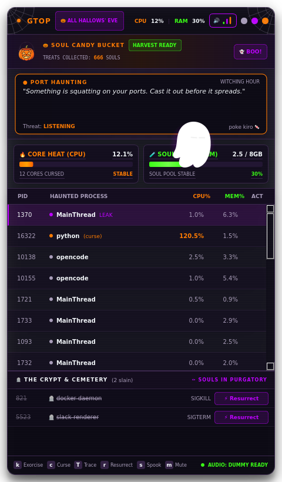

# 🎃 SpookCLI

[](https://pypi.org/project/spookcli/)
[](https://pypi.org/project/spookcli/)
[](https://github.com/saveduser/spook-cli/actions/workflows/ci.yml)
[](https://github.com/saveduser/spook-cli/blob/main/LICENSE)

> A Halloween-themed CLI that summons ghosts when your commands fail — with
> **gtop**, a live haunted process monitor underneath.

## Install

```bash
pipx install spookcli   # recommended: isolated CLI install
# or
pip install spookcli
```

Requires **Python 3.10–3.13**. On Linux, install the audio and emoji runtime
libraries:

```bash
sudo apt install libpulse0 fonts-noto-color-emoji
```

Then:

```bash
spook run echo "hello world"                    # success  ✅
spook run python -c "import sys; sys.exit(1)"   # failure  💀
spook gtop                                      # haunted process monitor
```

## Usage

```
spook run <command> [args...]
spook gtop
spook board
spook install-hook
spook test-ghost
```

## Development install

```bash
git clone https://github.com/saveduser/spook-cli
cd spook-cli
uv venv
source .venv/bin/activate        # Windows: .\.venv\Scripts\Activate.ps1
uv pip install -e ".[dev]"
pytest -q
```

## 🩸 gtop — Haunted Process Monitor



`spook gtop` opens a frameless, glassmorphic PyQt6 monitor that streams live
`psutil` telemetry into a haunted process table. It is not a screenshot: the
gauges, process rows, mascot, candy bucket, and flying Kiro all run live.

| Feature | What it does |
|---|---|
| **Port Hauntings** | Maps listening TCP ports to their owning PIDs. Holders of `8080`, `3000`, or `5432` (plus `8000`, `5173`, `3306`, `6379`) get a port badge and an always-visible ☠ button for one-click Exorcise. |
| **Curse / Uncurse** | `c` suspends the selected process (`SIGSTOP`) and paints its row icy blue; pressing `c` again resumes it (`SIGCONT`). Cursed rows stay pinned at the top so the curse can always be lifted, and exiting `gtop` automatically resumes every cursed process. PID `0`, `1`, and `gtop` itself are protected. |
| **Trace Bloodline** | `Shift+T` expands the selected process into its full descendant tree, indented by generation. The leaking branch is highlighted, and the suspected leak carries a `LEAK` tag. |
| **Bloodline leak detection** | Tracks RSS growth across recent snapshots and flags the fastest-growing process; falls back to the largest resident process when nothing is visibly climbing. |
| **Soul gauges** | Live CPU (`CORE HEAT`) and RAM (`SOUL POOL`) bars with animated fills and overflow states. |
| **Crypt & candy** | Exorcised processes land in the crypt; every kill feeds the soul-candy bucket and summons ghosts. |
| **Kiro mascot** | A taunting Kiro, rotating OS whispers, a clickable candy bucket, and an 18-second flying-Kiro patrol. |

### Keybindings

| Key | Action |
|---|---|
| `k` | Exorcise selected process |
| `c` | Curse / uncurse selected process |
| `Shift+T` | Toggle bloodline trace for selected process |
| `r` | Resurrect the newest crypt entry |
| `s` | Spook (scream, shake, ghost swarm) |
| `m` | Mute / unmute audio |
| `↑` / `↓` | Move process selection |
| `q` / `Esc` | Exit (resumes all cursed processes) |

## Project Structure

```
spookcli/
├── pyproject.toml          # project metadata, dependencies, build config
├── README.md
├── CHANGELOG.md
├── ASSETS.md               # provenance and licensing notes for bundled media
├── LICENSE
├── .github/workflows/      # CI + Trusted Publishing release pipelines
├── tests/                  # pytest suite (CLI, assets, gtop smoke)
└── spookcli/
    ├── __init__.py         # __version__ — single source of truth
    ├── cli.py              # click entrypoint — run, gtop, board, hooks
    ├── runner.py           # subprocess wrapper, real-time streaming
    ├── board.py            # BBS scoreboard and kill ledger
    ├── ghost.py            # ghost event audio + Qt overlay
    ├── gtop.py             # PyQt6 haunted process monitor
    ├── whispers.py         # rotating Kiro prophecies
    └── assets/             # packaged GIF, PNG, WAV, and MP3 assets
        ├── blinking_ghost.gif
        ├── ghost-kiro-blink.gif
        ├── pumpkin.png
        ├── ghost_scream.wav
        ├── collected.wav
        ├── exorcism1.wav
        ├── exorcism2.wav
        ├── Ghost_in_the_Cabinet.mp3
        └── Possessed_High_Score.mp3
```

## Ghost Effects

`spookcli/ghost.py` owns the failure overlay:

| Component | Library | Behaviour |
|---|---|---|
| `_play_sound()` | `pygame` | Loads `spookcli/assets/ghost_scream.wav`; silently no-ops if audio is unavailable |
| `_show_ghost_overlay()` | `PyQt6` | Frameless, translucent Kiro overlay with speech bubble and auto-dismiss |

## Linux audio & emoji fonts

`gtop` and the ghost overlay fall back to silent mode when no audio device is
available. For PulseAudio support and colour emoji glyphs on Debian/Ubuntu/WSL:

```bash
sudo apt install libpulse0 fonts-noto-color-emoji
```

The app ships its own GIF/PNG mascot and pumpkin assets inside the wheel, so the
UI still renders without emoji fonts.

## Dependencies

| Package | Constraint | Tested | Purpose |
|---|---|---|---|
| `click` | `>=8.1,<9` | 8.1.8 | CLI parsing, coloured output |
| `pygame` | `>=2.6,<3` | 2.6.1 | Optional audio playback |
| `PyQt6` | `>=6.8,<7` | 6.8.1 | `gtop` and ghost overlay |
| `psutil` | `>=6.1,<8` | 6.1.1 | Process, memory, and port telemetry |

Python support is pinned to `>=3.10,<3.14` because the tested PyQt6 and pygame
releases publish wheels for CPython 3.10 through 3.13.

## 🧛 Built with Kiro

The agent substrate lives in `.kiro/` and is part of the project, not an
afterthought:

| Artifact | Role |
|---|---|
| `.kiro/specs/gtop-ui-spec.md` | UI contract for the monitor, including the three haunting features |
| `.kiro/specs/system-whispers-spec.md` | Behaviour of the rotating OS whisper engine |
| `.kiro/steering/architecture-rules.md` | PyQt6/frameless/psutil/`QThread` invariants |
| `.kiro/steering/cross-platform-rules.md` | Audio, file-I/O, and ANSI safety rules |
| `.kiro/steering/aesthetic-guidelines.md` | Palette, type, and decoration constraints |
| `.kiro/hooks/on_error.json` | Agent hook that reacts to failed commands |
| `.kiro/settings/mcp.json` | MCP configuration used while building `gtop` |

The `gtop` UI was specified in Kiro and implemented against those steering
rules; the Stitch MCP design reference is recorded in the spec.

See [`docs/kiro-usage.md`](https://github.com/saveduser/spook-cli/blob/main/docs/kiro-usage.md) for the concrete build story:
which specs drove which files, which steering rules changed the output, and how
the hooks and MCP server were used.
